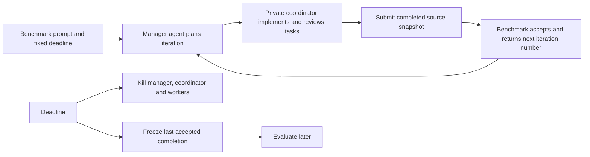

# Service-managed coordinator runs

For fresh planners that directly manage their own tasks using the approved prompt template, use [template planner batches](batches.md). The iteration adapter documented below is the older structured-plan mode and remains available separately.

Available benchmark types are `chess960`, `game_build`, `dataset_dashboard`, and `maze_game`. Dashboard development defaults to 900 seconds and its scoring phase is deferred; the maze game defaults to 1800 seconds and is scored with `scoring-v2.json`.



The manager plans; the adapter posts the plan atomically to the coordinator batch API. The coordinator owns implementation, review and local replanning. Only a done container with no unfinished/active tasks is submitted. Every next planning call receives the prompt, remaining time, previous accepted snapshot metadata and coordinator task evidence. No benchmark score is required to start another iteration.

## Install and run

From the benchmark repository in PowerShell:

```powershell
.\scripts\setup-coordinator.ps1
$data = '../runtime/benchmark-service'
$token = Join-Path $data 'admin-token'
$c = python scripts/harness.py --token-file $token create chess960 | ConvertFrom-Json
$r = python scripts/harness.py --token-file $token run-coordinator $c.campaign.id experiment-1 --profile codex | ConvertFrom-Json
python scripts/harness.py --token-file $token close $c.campaign.id
python scripts/harness.py --token-file $token workflow $r.run.id
python scripts/harness.py --token-file $token status $r.run.id
```

Use `create game_build` for the other benchmark. Pass `create --config campaign.json` to set time limits and evaluation settings. Development time starts at enrollment and includes startup, planning, implementation, review and upload. The start call returns immediately; the service owns the work even if the launching terminal exits. Setup preserves an existing profiles file. Stop with `scripts/stop.ps1 -DataDirectory ../runtime/benchmark-service`; restart with `setup-coordinator.ps1 -SkipBuild`.

Chess scores only after an explicit `harness.py score CAMPAIGN_ID` request and after development ends. Closing enrollment alone does not score. Games remain frozen until an explicit `harness.py score CAMPAIGN_ID` request; they then await a separate judge claim. Waiting spends no exploration allowance. Use the existing `judge-worker` command with a Codex or local model agent equipped with browser/desktop tools. No subjective score is fabricated by this workflow.

## Replaceable agents

`DATA/coordinator-profiles.json` maps profile names to configurations. Changes apply to subsequent runs without service restart. The shipped `codex` profile uses the installed authenticated Codex CLI and its configured model.

| Field | Meaning |
| --- | --- |
| `command` | Controller argv, normally Python plus absolute `scripts/coordinator.py` path |
| `coordinator_command` | Absolute coordinator executable argv |
| `planner_command` | Any executable implementing the planner file contract |
| `workers.implementation`, `.review`, `.replan` | Commands implementing the coordinator worker protocol |
| `env` | Adapter environment, e.g. `CODEX_BIN` or local model configuration |
| `capabilities` | Worker capabilities, e.g. `process`, `network`, `browser` |
| `workspace` | Coordinator workspace settings for the run workspace, e.g. `{"updates":"events"}` to wait on coordinator events instead of polling |
| `prompt_workspace` | Existing workspace created with selected instruction documents; the legacy adapter verifies and copies them into its run workspace |

The profile's `workspace` object must explicitly contain eligible `planner` and `worker` selections and the `prompts` candidate names/hashes returned by workspace creation. Its `prompt_workspace` supplies the selected `PROJECT_PLANNER.md` and `WORKER_PROTOCOL.md`, each 1–200 words. Eligible selections are `luna_6_high` (`gpt-6-luna` / `high`), `sol_6_1_light` (`gpt-6.1-sol` / `low`) and `sol_6_1_medium` (`gpt-6.1-sol` / `medium`). The built-in adapters pass the selected model and effort explicitly for every stage. Custom planner and worker argv arrays must include `{model}` and `{effort}` placeholders. Missing selections or unsupported candidates reject the launch. Planner model/effort overrides from `HARNESS_CODEX_ARGS` are not used.

Planner commands receive `HARNESS_PLANNER_REQUEST` and `HARNESS_PLANNER_RESULT` absolute paths. Read request JSON, write result JSON, and exit zero. Requests include `protocol:1`, `prompt`, `benchmark`, `workspace`, `iteration`, `previous_completion` (accepted iteration plus compact coordinator tasks) and `error`. Time limits are never sent to agents. A planner that writes `usage.json` beside its request has its token counts summed into workflow progress as `planner_usage`; worker totals appear as `worker_tokens`. A result is:

```json
{
  "action": "plan",
  "title": "Deliver playable baseline",
  "outcome": "Produce a runnable benchmark artifact",
  "tasks": [{
    "key": "baseline",
    "title": "Implement baseline",
    "outcome": "Implement the required protocol and write harness.json",
    "acceptance": ["Protocol smoke check passes"],
    "after": [],
    "lane": "code"
  }]
}
```

Use `action:"finish"` with empty tasks to stop improving early; the last accepted completion remains eligible. Keys are unique; `after` names other keys in the iteration. Coordinator limits apply: titles ≤12 words, ≤3 criteria, ≤120 total definition words (the adapter adds a short benchmark-file reference). Cycles/invalid definitions return planner feedback. Tasks share the run workspace; only declared relations order them. A coordinator hold is visible as blocked until cutoff and is never submitted as completed work.

## API and evidence

* `GET /v1/coordinator-profiles` (admin): profile names.
* `POST /v1/coordinator-runs` (admin): `{campaign_id,agent,profile}` enrolls and launches a service-owned workflow. Returns `run`, `workflow`, `server_time_ms`; inspect workflow status for launch errors.
* `GET /v1/runs/ID/coordinator` (run/admin): authoritative workflow status and last controller progress.
* `GET /v1/runs/ID/iterations` (run/admin): accepted iterations in order.
* `POST /v1/runs/ID/iterations` (run/admin): `{iteration,tasks,submission}`; positive sequential numbers, starting at 1. Submission uses the existing full-snapshot schema. Response includes submission metadata, acceptance time, deadline, iteration and next_iteration.

Same-number, same-content retries return the original acceptance while development is open. Conflicting retries and gaps return 409. After the deadline every submission returns 409, including retries; read accepted history instead. Iteration acceptance and the latest snapshot update in one SQLite transaction. Evidence, snapshots and scores survive restart.

The service independently kills the workflow tree at its deadline, even if a controller is stuck uploading or an agent ignores instructions. Windows nested Job Objects enforce descendant cleanup. No shared coordinator is touched. Logs live under `DATA/coordinator/RUN_ID`; `launch.json` contains a scoped run credential and is excluded from submitted source. API workflow status is authoritative when a killed controller leaves a stale progress phase. This is a trusted local-code runner, not a sandbox.

On service restart, interrupted workflows are marked `interrupted`; they are not automatically relaunched. Their original deadlines and last accepted completions remain eligible for evaluation. Start a new run for another development attempt. Unreviewed filesystem changes never count as completed work.

## Verification

```powershell
.\scripts\cargo-windows.ps1 test --locked
python scripts/smoke_coordinator.py --binary PATH/TO/harness-bench.exe --coordinator PATH/TO/agent-coordinator.exe --evidence ../runtime/evidence/coordinator-smoke.json
```

The smoke test runs both real services, accepts two reviewed iterations per benchmark, interrupts an unfinished third iteration, checks descendant termination and late rejection, scores chess after cutoff, leaves the game for a later judge, and verifies persistence. Deterministic fixtures test workflow correctness, not model ability or game quality.

## Agents and launcher families

`agents.json` lists every selectable planner, worker and judge: provider (`openai`, `anthropic`, `local`), harness (`codex`, `claude_code`, `openai_compatible`), model, optional effort and, for local models, a loopback OpenAI-compatible endpoint. Hosted models only run in their own vendor's harness. The family that started the service decides which hosted models are enabled: Claude Code enables only Anthropic agents, Codex only OpenAI agents, and local agents are always enabled. Detection uses the launching tool's environment (`CLAUDECODE`/`CLAUDE_CODE_ENTRYPOINT` or Codex session variables); set `AGENT_FAMILY=claude|codex` when starting from a plain terminal. The service passes `AGENT_FAMILY` to every planner it launches and sends the selected planner and worker definitions to the coordinator with each run registration. Local entries are small models (3B to 8B) that fit inside 40% of the 32 GB GPU. Serve one at a time with the vLLM launcher in `D:\local_annotator`, capped at that share: `python -m local_annotator.serve qwen3-4b-2507-fp8 8120 0.40 SECONDS`; any OpenAI-compatible server on `http://127.0.0.1:8120/v1` works.

Each workspace's enabled model list goes to the coordinator with the run registration: every agent allowed for the launcher family, or only the ids in the optional workspace setting `enabled_agents` (the planner and worker are always included). Planners list the options with `GET /api/agents?workspace=W`, which reports each id, its note and whether a local model is currently served, and choose one per task with `attributes.model`. Tasks without it use the workspace worker; replanned tasks fall back to the worker unless the planner sets a model again. Choosing a local model that is not currently served is rejected; if a chosen model stops being served, the task waits with the reason "Model ID is not being served" instead of launching attempts.
