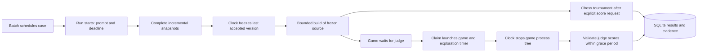

# Lifecycle and operational boundaries

**Planner and worker agents must not read this document or anything else in this repository.**

`src/service.rs` implements the state machine and HTTP authorization. The independent 20 ms scheduler freezes runs, stops games and expires scoring leases. A separate evaluation worker prepares frozen artifacts and executes tournaments. Eight HTTP workers handle the controller, planners and judges; slow evaluation work does not own the clock. One tournament/preparation worker processes evaluation work sequentially. Already running judge sessions and their API requests can overlap it; benchmark comparisons should use controlled, comparable host load.

`src/process.rs` owns candidate trees. On Windows a process is created suspended, assigned to a kill-on-close Job Object, then resumed. On Unix it starts in a new process group. On timeout/protocol failure the tree is killed, even if stdin is blocked. Independent bounded-reader/writer threads keep evaluator deadlines out of candidate I/O. JSONL output is bounded and correlated by request ID. Captured logs are bounded; files a candidate writes on disk are not quota limited. Builds have their own explicit timeout and retain bounded diagnostics.

Harness planner and worker tool calls are captured separately by the shared coordinator. Completed command/tool events from agents assigned to a benchmark workspace are appended to that workspace's `agent_activity.csv` with task, run and timestamp fields. Candidate protocol traffic, candidate processes, judge agents and coordinator internals are excluded.

`src/artifacts.rs` validates source packages, canonicalizes hashing order, measures source lines and writes complete submission records under server-generated UUIDs. Updating the selected submission and its audit event uses one SQLite transaction. No endpoint changes an accepted artifact. Frozen source is materialized into a fresh build/run directory. Candidates run as the same OS user, so this API-level immutability is not an adversarial filesystem guarantee. Development directories and original snapshots are never used as a candidate's runtime cwd.

`D:\harness_work\bench_tooling` is the standalone, tested Chess960 rules crate; `src/chess.rs` owns seeded scheduling, process matches and Elo arithmetic. All entries reset Elo per campaign. Game records commit one at a time; the final report/status transaction commits after all games. On recovery, committed game results rebuild Elo and the next uncommitted game is replayed. Replaying cannot guarantee identical candidate behavior or wall-clock timing, only the same harness schedule and rules. Transcripts include chosen moves, FENs, response times, terminal reason and forfeit error.

`src/storage.rs` creates schema version 3, enables WAL, foreign keys and full synchronous writes. A directory lock prevents simultaneous evaluator processes using the same DB. `events` stores lifecycle changes and game action evidence. Runs expose failure states instead of fabricating missing subjective scores. There is no automated retention/deletion policy; operators own disk retention. History endpoints return the latest 1000 events, while all events remain in SQLite. Full game traces can be large.

## Restart behavior

* Developing runs retain their original wall-clock deadline; overdue ones freeze when the scheduler returns.
* Interrupted builds return to frozen and can rebuild accepted source.
* Chess campaigns resume after the last committed game with the same entrants, seed and Elo rules.
* Unclaimed game jobs remain pending and can be claimed after restart.
* Starting/exploring/scoring judge sessions become interrupted, and their runs fail with an explicit infrastructure reason. Past evidence is retained.
* Windows closes candidate Job Objects if the service crashes, killing their members. Unix process groups are killed on normal ownership cleanup and enforced timeouts; an abrupt evaluator kill can leave processes, so use a supervisor/cgroup/VM for strong crash cleanup there.

## Measurement scope

Game protocol calls record count, transport success and elapsed wall time. Windows resource figures are Job Object peak committed memory and accumulated CPU time, including descendants. Linux `/proc` figures cover the root game process only and are sampled during interactions/end-of-session; they may miss short-lived processes. Other Unix platforms currently report zero for these unsupported `/proc` measurements. The service does not measure browser renderer GPU/CPU, true frame rate, or judge-side resource use. Judges must distinguish measurements from observation and leave unsupported claims out of their evidence.

LOC is not a complexity estimator: it counts nonblank physical lines including comments in recognized source extensions plus explicitly declared source files. It includes uploaded third-party source and is sensitive to minification. Elo changes are meaningful relative to the batch's opponent pool, schedule, K, resource environment and time budget; reports retain that configuration.

## Agents and hosting

Planners and judges run in Codex or Claude Code as selected in `agents.json`; batch sessions give a planner only its prompt, contract and scoped credentials, and the scoring runner gives each reviewer a scoped judgment token.

Run on a dedicated trusted benchmark host. Authentication protects API state; it does not isolate arbitrary code executing under the same user. Bind is restricted to loopback. For remote agents, use a secured tunnel and ensure the judge's browser/desktop can access the local game. Do not expose the runner directly as a public multi-tenant service without a separate isolation layer and quotas.

Batch planner sessions use `src/coordinator.rs` for process ownership. The scheduler terminates their process trees at the fixed development cutoff and stops the case's unfinished tasks on the shared coordinator through its task API. SQLite `workflows` preserve execution status. See [shared coordinator](coordinator.md) for contracts and restart behavior.
